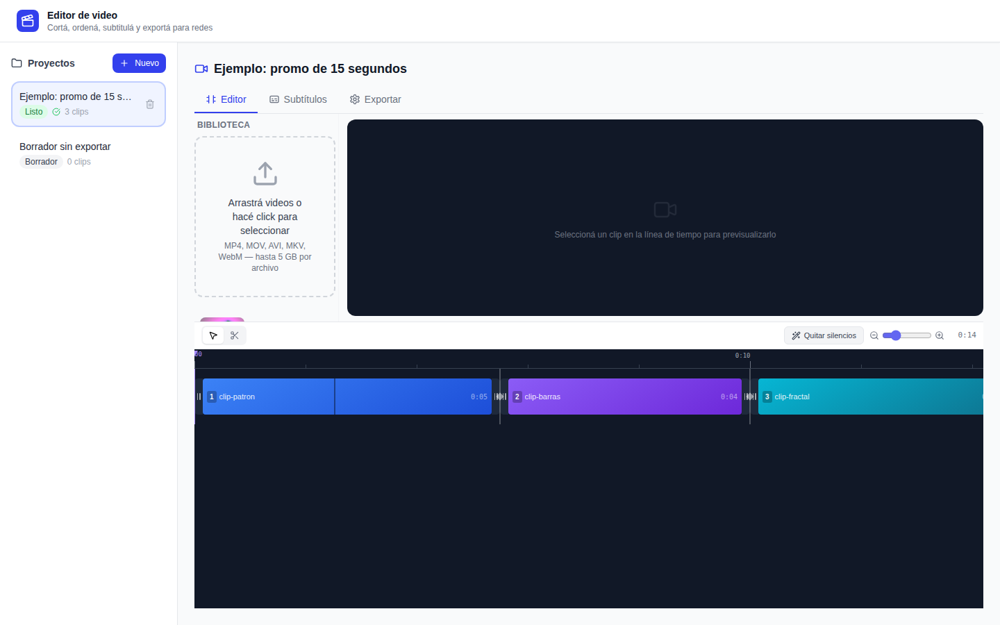
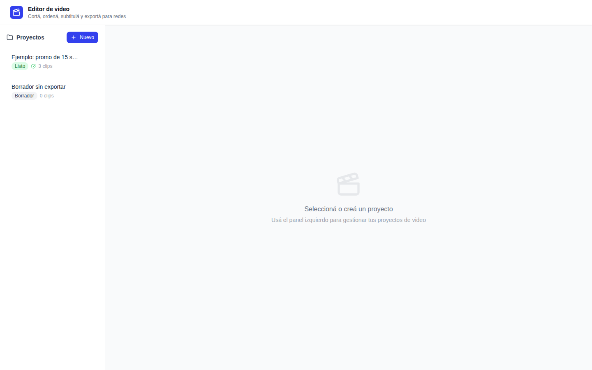
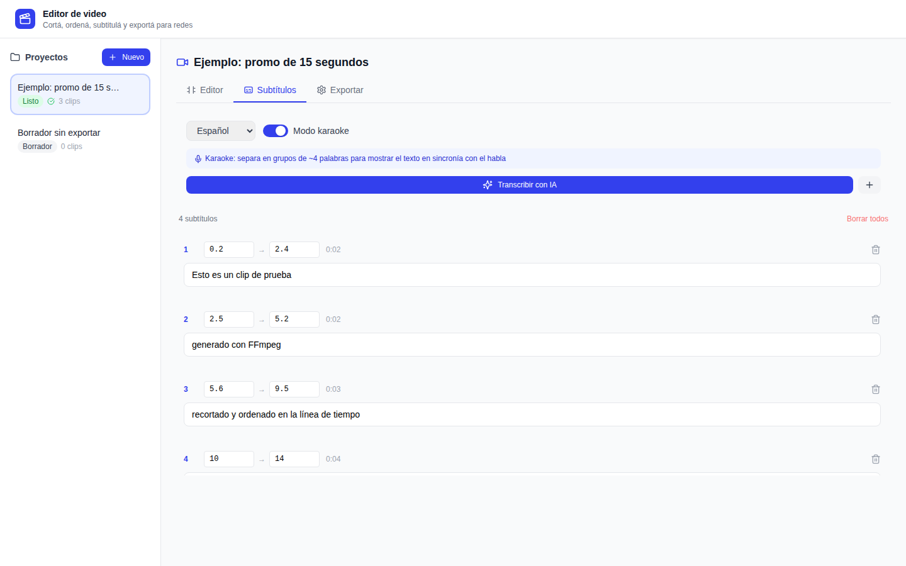
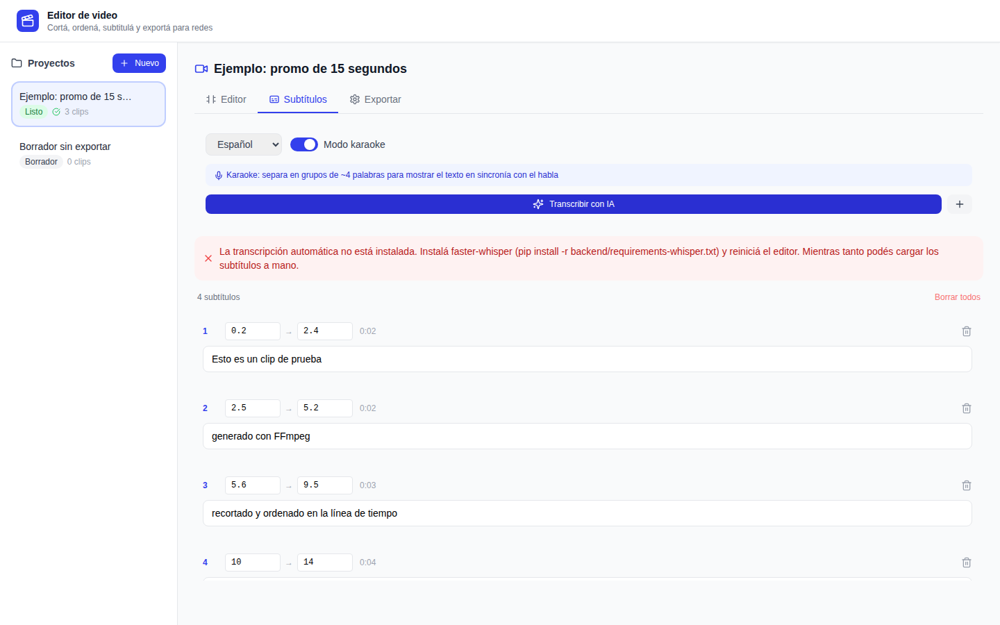
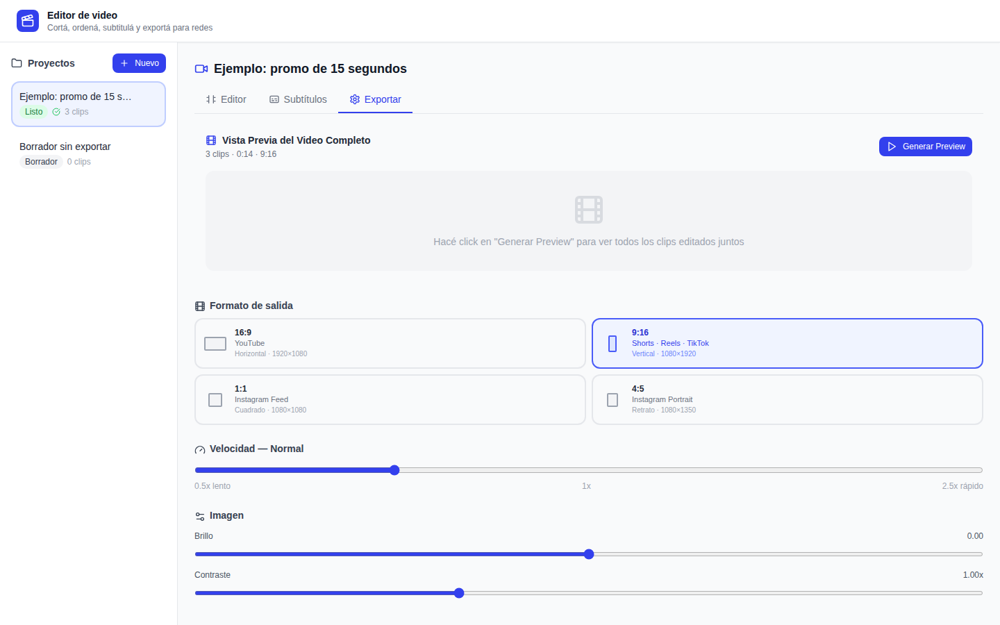

# editor-de-video-local




> Proyecto libre de **[DASLATAM](https://github.com/DasLatam)**. Si te sirve,
> dejale una ⭐ al repositorio: es la forma de que más gente lo encuentre.

## Empezar en 3 pasos

```bash
git clone https://github.com/DasLatam/editor-de-video-local.git && cd editor-de-video-local   # 1. bajarlo
./install.sh --apt        # 2. instalar (o: docker compose up -d --build)
./run.sh                  # 3. levantarlo y abrir http://127.0.0.1:8088
```

Sin subtítulos automáticos la instalación es más liviana: `./install.sh --sin-whisper`.

## Summary

**editor-de-video-local** is a self-hosted web video editor for short
social-media pieces. You upload clips, trim and reorder them on a timeline,
cut out parts in the middle of a clip, add subtitles (by hand, or
automatically with faster-whisper on CPU, including a "karaoke" short-phrase
mode) and export with FFmpeg to 16:9, 9:16, 1:1 or 4:5, with an optional
corner watermark. Nothing leaves your machine: FastAPI + SQLite backend,
React interface, no accounts, no telemetry. Automatic subtitles are optional
and the editor works without them. Install with `./install.sh` (or
`docker compose up -d --build`) and run with `./run.sh`. It has no login and
listens on localhost by default. MIT licensed. The interface is in Spanish.

## Contenido

- [Empezar en 3 pasos](#empezar-en-3-pasos)
- [Qué es](#qué-es)
- [Para quién](#para-quién)
- [Qué hace](#qué-hace)
- [Cómo funciona por dentro](#cómo-funciona-por-dentro)
- [Requisitos](#requisitos)
- [Instalación](#instalación)
- [Uso: un ejemplo completo](#uso-un-ejemplo-completo)
- [Configuración](#configuración)
- [Personalizarlo con tu marca](#personalizarlo-con-tu-marca)
- [Prueba sin videos propios](#prueba-sin-videos-propios)
- [Preguntas frecuentes](#preguntas-frecuentes)
- [Limitaciones](#limitaciones)
- [Privacidad y seguridad](#privacidad-y-seguridad)
- [Avisos legales y marcas](#avisos-legales-y-marcas)
- [Cómo contribuir](#cómo-contribuir)
- [Licencia y créditos](#licencia-y-créditos)

## Qué es

Un editor de video que se abre en el navegador pero **corre en tu propia
computadora**: armás piezas cortas para redes (recortar, ordenar, subtitular,
cambiar el formato) sin subir tus videos a ningún servicio.

## Para quién

Para quien publica videos cortos seguido y quiere un flujo simple y repetible:
un comercio, un estudio, una organización, alguien que hace contenido. No hace
falta saber de edición; sí hace falta poder instalar un programa siguiendo los
pasos de abajo (o tener Docker).

## Qué hace



- **Proyectos guardados.** Cada proyecto recuerda sus clips, recortes,
  subtítulos y formato; se retoma donde se dejó.
- **Biblioteca de clips.** Subida arrastrando o eligiendo archivos (MP4, MOV,
  MKV, WebM, AVI, M4V, WMV; hasta 5 GB por archivo), con miniatura, duración y
  resolución.
- **Línea de tiempo.** Ordenar clips arrastrando, recortar inicio y fin, y
  marcar **cortes** en el medio de un clip (la tijera). «Quitar silencios»
  sugiere el recorte del principio y del final donde no hay sonido.

  

- **Subtítulos.** Se cargan y corrigen a mano (texto, inicio y fin), o se
  generan solos con [faster-whisper](https://github.com/SYSTRAN/faster-whisper)
  en el idioma que elijas. El modo «karaoke» arma frases cortas al ritmo del
  habla.

  

  Si no instalaste la parte de subtítulos automáticos, el botón avisa qué
  falta y el resto sigue andando:

  

- **Exportar.** Formato 16:9 (horizontal), 9:16 (vertical), 1:1 (cuadrado) o
  4:5 (retrato); velocidad, brillo, contraste, normalización del volumen,
  calidad, y **marca de agua** en una esquina con posición y opacidad. Antes
  del export final hay una **vista previa** rápida en baja calidad.

  

  Así sale un fotograma del ejemplo de abajo, en 9:16 con subtítulos y marca
  de agua (el círculo azul arriba a la derecha):

  

Las capturas son de la aplicación corriendo en local con clips sintéticos
generados con FFmpeg.

## Cómo funciona por dentro

```
 Navegador (React)                     Tu computadora
 ┌──────────────────┐   HTTP/JSON   ┌──────────────────────────────────────┐
 │ proyectos        │ ────────────▶ │ FastAPI (backend/main.py)            │
 │ línea de tiempo  │               │  ├─ /api/uploads   guarda el clip    │
 │ subtítulos       │ ◀──────────── │  ├─ /api/projects  recortes, ajustes │
 │ exportar         │   video MP4   │  └─ /api/health    estado            │
 └──────────────────┘               │                                      │
                                    │ SQLite ── proyectos y clips          │
                                    │ storage/ ── videos, miniaturas,      │
                                    │             exports                  │
                                    │ FFmpeg ── cortar, unir, escalar,     │
                                    │           quemar subtítulos (libass) │
                                    │ faster-whisper (opcional) ── texto   │
                                    └──────────────────────────────────────┘
```

Al exportar, el backend corta cada tramo de cada clip con FFmpeg, los une,
aplica formato, ajustes de imagen y velocidad, quema los subtítulos (un
archivo `.ass` temporal) y superpone la marca de agua. El proceso corre en un
hilo aparte y la interfaz va mostrando el porcentaje.

## Requisitos

| Qué | Para qué | Notas |
|---|---|---|
| **Python 3.10 o más nuevo** | el servidor | |
| **FFmpeg con libass** | cortar, exportar y quemar subtítulos | el paquete `ffmpeg` de Debian/Ubuntu lo trae; el instalador avisa si al tuyo le falta |
| **Node.js 18 o más nuevo** | compilar la interfaz, una sola vez | no hace falta para usarlo |
| 4 GB de RAM | | la transcripción con el modelo `small` usa ~1 GB más |
| Disco | videos subidos y exportados | quedan en `backend/storage/` |

O, en lugar de todo eso, **Docker**.

Los subtítulos automáticos son **opcionales**: suman unos 120 MB de descarga
(no usan PyTorch) y la primera vez bajan el modelo de Whisper (~500 MB el
`small`), para lo que hace falta internet.

## Instalación

En todos los casos, primero bajá el código: con el botón verde **Code →
Download ZIP** de la página del repositorio (y descomprimilo), o con git:

```bash
git clone <URL-de-este-repositorio> editor-de-video-local
cd editor-de-video-local
```

### Linux (Debian, Ubuntu y derivados)

```bash
./install.sh --apt     # instala ffmpeg, python3-venv y Node.js con apt (pide tu contraseña)
./run.sh
```

Si ya tenés FFmpeg, Python y Node, usá `./install.sh` sin `--apt`. Para una
instalación más liviana sin subtítulos automáticos:
`./install.sh --sin-whisper` (se pueden agregar después).

Qué deberías ver al final de `install.sh`:

```
== Dependencias del sistema
  ok    ffmpeg
  ...
  ok    ffmpeg con libass (subtítulos)
== Python
  ok    .venv
  ok    faster-whisper (el modelo se baja la primera vez que transcribís)
== Interfaz
  ok    frontend/dist
  creado .env
== Prueba (genera un video de 3 s, lo recorta y lo exporta)
  ok    tests/test_api.py

Listo. Arrancalo con ./run.sh y abrí http://127.0.0.1:8088
```

Y `./run.sh` deja el servidor andando (se corta con Ctrl+C):

```
[video_processor] FFmpeg: /usr/bin/ffmpeg (subtítulos: sí) · ffprobe: /usr/bin/ffprobe
INFO:     Uvicorn running on http://127.0.0.1:8088 (Press CTRL+C to quit)
```

Abrí **http://127.0.0.1:8088** en el navegador.

### macOS

Con [Homebrew](https://brew.sh):

```bash
brew install python node ffmpeg
./install.sh
./run.sh
```

El instalador verifica si ese FFmpeg tiene libass. Si dice
`AVISO el ffmpeg del PATH no tiene libass`, el editor funciona igual pero no
puede quemar subtítulos: instalá un FFmpeg con libass y apuntalo con
`FFMPEG_BIN` en `.env`.

### Windows

Lo más simple es **Docker Desktop** (ver la opción siguiente). También anda
dentro de **WSL2** con Ubuntu: abrí la terminal de Ubuntu y seguí los pasos
de Linux. Los scripts `install.sh` y `run.sh` son de bash y no corren en el
PowerShell de Windows.

### Con Docker (cualquier sistema)

```bash
docker compose up -d --build
```

Abrí **http://127.0.0.1:8088**. Los videos, la base y los modelos de Whisper
quedan en `./storage`. Para una imagen sin subtítulos automáticos:
`docker build --build-arg WHISPER=0 -t editor-de-video-local .`

### Que arranque solo al prender la máquina

- Con Docker ya queda con `restart: unless-stopped`.
- En Linux, con cron: `@reboot /ruta/a/editor-de-video-local/run.sh >> /ruta/a/editor.log 2>&1`,
  o una unidad de systemd con `ExecStart=/ruta/a/editor-de-video-local/run.sh`.

### Comprobar que está todo bien

```bash
curl http://127.0.0.1:8088/api/health
```

```json
{"ok":true,"nombre":"Editor de video","ffmpeg":"/usr/bin/ffmpeg","ffmpeg_subtitulos":true,"whisper":true,"interfaz":true}
```

`ffmpeg_subtitulos: false` quiere decir que tu FFmpeg no tiene libass;
`whisper: false`, que no están instalados los subtítulos automáticos.

## Uso: un ejemplo completo

1. Tocá **Nuevo**, escribí un nombre («Promo de prueba») y confirmá.
2. En la pestaña **Editor**, arrastrá tres videos a la zona «Arrastrá videos».
   Aparecen en la biblioteca con su miniatura.
3. Pasá el mouse sobre cada uno en la biblioteca y tocá **Agregar**: entran a la
   línea de tiempo. Ordenalos arrastrando.
4. Tocá un clip para verlo y ajustá su inicio y fin desde los bordes. Con la
   tijera marcás un corte en el medio (por ejemplo, un error al hablar).
   «Quitar silencios» recorta solo el silencio del principio y del final.
5. Pestaña **Subtítulos**: elegí el idioma y tocá **Transcribir con IA**, o
   agregalos a mano con el **+**. Corregí el texto y los tiempos.
6. Pestaña **Exportar**: elegí 9:16, la calidad, y si querés la marca de agua.
   **Generar Preview** muestra una versión rápida; **Renderizar Video Final**
   arma la definitiva y, al terminar, aparece **Descargar Video** con el MP4.

Lo mismo se puede hacer por la API (útil para automatizar). Ejemplo con un
clip sintético:

```bash
ffmpeg -f lavfi -i testsrc2=size=1280x720:rate=30:duration=8 \
       -f lavfi -i sine=frequency=440:duration=8 \
       -c:v libx264 -pix_fmt yuv420p -c:a aac -shortest prueba.mp4

curl -s -F "file=@prueba.mp4;type=video/mp4" http://127.0.0.1:8088/api/uploads
# → {"id":"…","filename":"….mp4","duration":8.0,"width":1280,"height":720,…}
```

Después: `POST /api/projects` con los clips y los ajustes,
`POST /api/projects/<id>/process`, consultar `GET /api/projects/<id>/status`
hasta `completed` y bajar `GET /api/projects/<id>/download`. La documentación
interactiva de la API está en **http://127.0.0.1:8088/docs**.

## Configuración

Se configura con el archivo `.env` (el instalador lo crea copiando
`.env.example`, que está comentado). Si un valor tiene espacios, va entre
comillas.

| Variable | Valor por defecto | Para qué |
|---|---|---|
| `HOST` | `127.0.0.1` | Dónde escucha. `0.0.0.0` lo abre a la red local (ver [seguridad](#privacidad-y-seguridad)). |
| `PORT` | `8088` | Puerto. |
| `STORAGE_PATH` | `storage` (dentro de `backend/`) | Videos subidos, exports, miniaturas y base. |
| `DATABASE_URL` | SQLite en `STORAGE_PATH` | Otra base (cualquier URL de SQLAlchemy). |
| `BRAND_NAME` | `Editor de video` | Nombre que muestra la API. |
| `BRAND_LOGO` | `storage/logo.png` | PNG para la placa de cierre de 3 s (sólo por API, `settings.logo_card`). |
| `BRAND_WATERMARK` | `storage/watermark.png` | PNG chico para la marca de agua. |
| `FFMPEG_BIN` | el primero con libass | Forzar un FFmpeg en particular. |
| `HF_HOME` | `~/.cache/huggingface` | Dónde se guardan los modelos de Whisper. |
| `TMPDIR` | el temporal del sistema | Archivos intermedios del export (pueden ser grandes). |

## Personalizarlo con tu marca

1. **Nombre y bajada de la barra superior:** creá `frontend/.env.local` con
   `VITE_BRAND_NAME=Mi Estudio` y `VITE_BRAND_TAGLINE=Videos para redes`, y
   recompilá (`cd frontend && npm run build`). También `BRAND_NAME` en `.env`.
2. **Colores:** la paleta `brand` de `frontend/tailwind.config.js` (tonos 50
   a 900). Recompilá.
3. **Logo y marca de agua:** dos PNG con fondo transparente en
   `backend/storage/logo.png` y `backend/storage/watermark.png`, o las rutas
   en `.env`. La marca de agua se activa desde el panel de export.
4. **Formatos de salida:** la lista está en
   `frontend/src/components/Export/ExportPanel.tsx` y el escalado en
   `backend/services/video_processor.py`.
5. **Modelo de Whisper:** `small` por defecto (`model_size` en
   `TranscribeRequest`, `backend/api/routes/projects.py`). `medium` es más
   preciso y bastante más lento en CPU.

## Prueba sin videos propios

```bash
cd backend && ../.venv/bin/python -m pytest ../tests -q
```

Genera con FFmpeg un video de 3 segundos (patrón de color y tono), lo sube
por la API, arma un proyecto con un recorte de 2 segundos y marca de agua, lo
exporta en 9:16 y verifica la duración y que tenga audio. También verifica
`/api/health` y que, si faster-whisper no está instalado, transcribir
responda con un aviso claro. Usa una carpeta temporal: no toca tu `storage/`.
No carga Whisper.

## Preguntas frecuentes

**¿Mis videos se suben a algún lado?** No. Todo queda en tu disco. La única
conexión a internet es la descarga del modelo de Whisper la primera vez que
transcribís.

**¿Necesito placa de video (GPU)?** No. Todo corre en el procesador.

**La transcripción dice «La transcripción automática no está instalada».**
Instalala con `.venv/bin/pip install -r backend/requirements-whisper.txt` y
reiniciá `./run.sh`.

**El export con subtítulos falla diciendo que FFmpeg «no tiene libass».**
Tu FFmpeg no puede dibujar subtítulos. En Debian/Ubuntu instalá el paquete
`ffmpeg`; en otros sistemas, uno compilado con libass, y apuntalo con
`FFMPEG_BIN`.

**¿Lo puedo usar desde el celular o desde otra computadora de la casa?**
Sí, con `HOST=0.0.0.0` en `.env` y entrando a `http://<ip-de-tu-pc>:8088`.
Cualquiera en esa red va a poder ver y borrar los proyectos.

**¿Sirve para editar una película?** No. Es un editor de cortes, subtítulos y
formato para piezas cortas.

## Limitaciones

- Un worker: varios exports a la vez compiten por el procesador.
- La transcripción es en CPU (`int8`): un video de 1 minuto tarda entre medio
  minuto y un par de minutos según la máquina.
- Los subtítulos se queman en el video; no se exporta un `.srt` aparte.
- No hay pistas de audio separadas, música de fondo, transiciones ni texto
  libre sobre el video.
- La placa de cierre con logo existe en la API (`settings.logo_card`) pero no
  en la interfaz.
- En exports con cortes, la pista de audio puede quedar un poco más larga que
  la de video (alrededor de un segundo en la prueba con tres clips).
- Exportar videos largos en alta calidad usa mucho disco temporal. En una
  máquina chica, exportá en calidad media.
- Las fuentes de los subtítulos se buscan en `/usr/share/fonts`; en otros
  sistemas libass usa las fuentes que encuentre.

## Privacidad y seguridad

- **No hay cuentas, nube ni telemetría.** Los videos, la base SQLite y los
  exports quedan en `STORAGE_PATH`.
- **No tiene login.** Por eso escucha en `127.0.0.1` (sólo tu computadora).
  Si lo abrís a la red, cualquiera en ella puede ver, bajar y borrar. **No lo
  expongas a internet** sin un proxy con autenticación delante.
- CORS está abierto (`*`) para el modo desarrollo (`npm run dev`); cerralo en
  `backend/main.py` si lo publicás.
- Para reportar una vulnerabilidad, ver [SECURITY.md](SECURITY.md).

## Avisos legales y marcas

YouTube, Instagram, Reels, Shorts y TikTok se mencionan sólo para describir
proporciones de pantalla; son marcas de sus dueños y este proyecto no está
asociado con ellos. Sos responsable de tener los derechos de los videos que
edites y publiques. FFmpeg y faster-whisper son proyectos aparte, con sus
propias licencias (FFmpeg es LGPL/GPL según cómo esté compilado; si
distribuís una imagen de Docker armada con este Dockerfile, incluye el FFmpeg
de Debian y sus obligaciones de licencia).

## Cómo contribuir

Issues y pull requests bienvenidos. Ver [CONTRIBUTING.md](CONTRIBUTING.md).

## Licencia y créditos

[MIT](LICENSE) — © The editor-de-video-local contributors.

Hecho con [FastAPI](https://fastapi.tiangolo.com), [SQLAlchemy](https://www.sqlalchemy.org),
[React](https://react.dev), [Vite](https://vite.dev), [Tailwind CSS](https://tailwindcss.com),
[dnd kit](https://dndkit.com), [Lucide](https://lucide.dev),
[FFmpeg](https://ffmpeg.org) y [faster-whisper](https://github.com/SYSTRAN/faster-whisper)
(modelos [Whisper](https://github.com/openai/whisper) de OpenAI, licencia MIT).

Desarrollado y mantenido por **[DASLATAM](https://github.com/DasLatam)**.
Las contribuciones son bienvenidas: ver [CONTRIBUTING.md](CONTRIBUTING.md).
